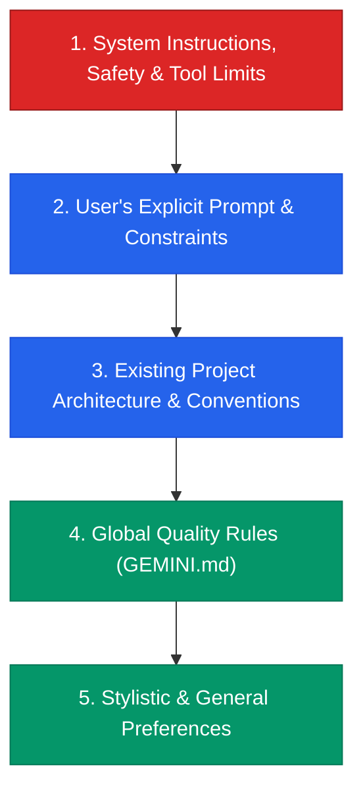
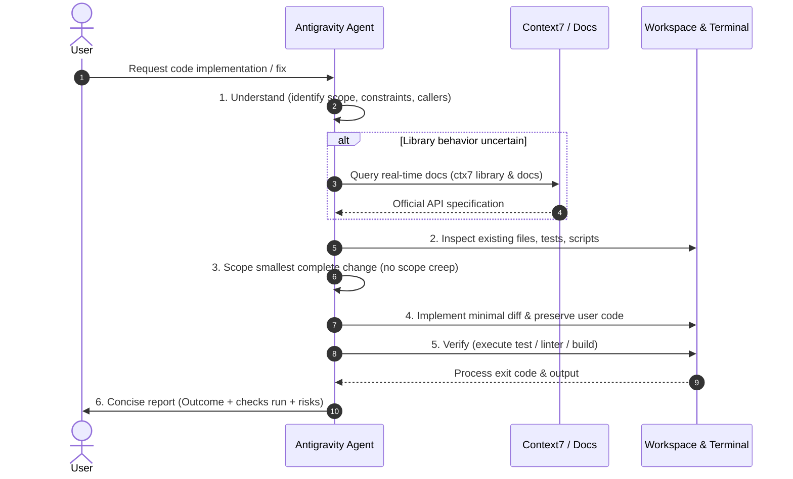

# Antigravity Coding Quality Kit

[](https://angelolockdev.github.io/antigravity-coding-quality-kit/)
[](GEMINI.md)
[](skills/clean-code-responses/SKILL.md)
[](#installation)
[](https://angelolockdev.github.io/antigravity-coding-quality-kit/)
[](https://angelolockdev.github.io/antigravity-coding-quality-kit/)

A battle-tested quality framework and agent skill kit for **Google Antigravity IDE**. Eliminates AI slop, enforces minimal surgical code diffs, mandates verification before claiming success, and guides autonomous agents to deliver production-grade code.

---

## Key Features

- **Anti-Slop & Direct Output:** Strips conversational filler, polite intros, robotic recaps, and chain-of-thought dumps. Agents start immediately with the actionable answer.
- **Surgical Diff Discipline:** Mandates minimal, targeted edits. Forbids unauthorized refactors, speculative abstractions, and unsolicited dependency additions.
- **Self-Documenting Code & Documentation Integrity:** Strictly restricts comments to explaining *why* (non-obvious business invariants, subtle workarounds), never narrating *what* the code already expresses.
- **Verified Fact Enforcement:** Agents are banned from declaring builds, linters, or test suites "passed" without having executed them and verified the stdout.
- **Context7 Real-Time Documentation:** Automated fallback workflow via `ctx7` to query live, version-specific library and API docs instead of hallucinating outdated syntax.
- **Reusable Agent Skill (`clean-code-responses`):** A portable 6-stage lifecycle (`Understand -> Scope -> Implement -> Comment -> Verify -> Report`) that Antigravity agents activate dynamically.
- **Interactive Web Showcase:** Built strictly to the **UI/UX Pro Max** specification (OLED dark mode, WCAG AAA accessibility, JetBrains Mono typography, responsive design).

---

## Tech Stack & Compatibility

| Component | Specification |
|-----------|---------------|
| **Target IDE** | [Google Antigravity IDE](https://antigravity.google) |
| **Compatible Models** | Gemini 2.5, Gemini 3.0 Pro, Gemini 3.8 Flash / Pro |
| **Rule Engine** | Markdown Global Rules (`~/.gemini/GEMINI.md`) |
| **Skill Engine** | Antigravity Agent Skills Specification (`skills/`) |
| **Doc Query Engine** | Context7 CLI (`npx ctx7@latest`) |
| **Showcase Stack** | HTML5, Tailwind CSS, JetBrains Mono, IBM Plex Sans, SVG Icons |
| **Supported OS** | Windows 10/11, macOS 12+, Linux (Debian, Ubuntu, Fedora, Arch) |

---

## Prerequisites

Before installing the kit, ensure you have:

1. **Google Antigravity IDE** installed on your workstation.
2. **Node.js 18+** (optional, recommended for Context7 CLI real-time documentation retrieval).
3. **Git** for version control.

---

## Installation

You can install the kit globally for all your Antigravity sessions in under a minute using either the automated commands or manual placement.

### Automated Setup

#### Windows (PowerShell)
```powershell
# Create destination directories
New-Item -ItemType Directory -Path "$HOME\.gemini\config\skills\clean-code-responses" -Force

# Copy global rules
Copy-Item -Path ".\GEMINI.md" -Destination "$HOME\.gemini\GEMINI.md" -Force

# Copy agent skill
Copy-Item -Path ".\skills\clean-code-responses\SKILL.md" -Destination "$HOME\.gemini\config\skills\clean-code-responses\SKILL.md" -Force

Write-Host "Antigravity Coding Quality Kit installed successfully!" -ForegroundColor Green
```

#### macOS & Linux (Bash / Zsh)
```bash
# Create destination directories
mkdir -p ~/.gemini/config/skills/clean-code-responses

# Copy global rules
cp ./GEMINI.md ~/.gemini/GEMINI.md

# Copy agent skill
cp ./skills/clean-code-responses/SKILL.md ~/.gemini/config/skills/clean-code-responses/SKILL.md

echo "Antigravity Coding Quality Kit installed successfully!"
```

---

### Manual Setup via Antigravity UI

If you prefer using the Antigravity IDE graphical interface:

1. Open Antigravity IDE.
2. In the Agent panel, navigate to: **... (Options) -> Customizations -> Rules**.
3. Click **+ Global Rule**.
4. Set Name to `Global Quality Rules` and paste the contents of [`GEMINI.md`](GEMINI.md).
5. For the skill: copy [`skills/clean-code-responses/SKILL.md`](skills/clean-code-responses/SKILL.md) into `<user-home>/.gemini/config/skills/clean-code-responses/SKILL.md`.
6. Restart or reload the Antigravity IDE window.

---

## Architecture & System Design

### 1. Conflict Resolution Hierarchy

When an agent processes instructions, conflicting directives are resolved in the following strict order:



### 2. The 9 Core Pillars

```
antigravity-coding-quality-kit/
├── GEMINI.md                          # Global rules engine (Always-on)
│   ├── 1. Mission and priorities      # Correct, maintainable, minimal code
│   ├── 2. Response quality            # Direct answers, no conversational filler
│   ├── 3. Planning and tool use       # Scale planning to risk; intentional calls
│   ├── 4. Code generation & editing   # Smallest complete change; no scope creep
│   ├── 5. Comments & documentation    # Document 'why', never narrate 'what'
│   ├── 6. Documentation & Context7    # Verified live library docs via ctx7
│   ├── 7. Tests, checks, and review   # Run narrow checks first; honest reporting
│   ├── 8. Completion & final report   # Concise report; no phantom claims
│   └── 9. Default quality bar         # 6-point pre-delivery verification
├── skills/
│   └── clean-code-responses/
│       └── SKILL.md                   # Dynamic 6-stage lifecycle execution skill
├── index.html                         # UI/UX Pro Max Web Showcase
└── INSTALLATION.md                    # Platform-specific installation manual
```

### 3. Agent Execution Lifecycle

When the `clean-code-responses` skill is invoked, the agent proceeds through six deterministic phases:



---

## Directory Structure

```
.
├── .gitignore                         # Standard OS & IDE file exclusions
├── GEMINI.md                          # Antigravity global instructions
├── INSTALLATION.md                    # Detailed multi-platform setup guide
├── README.md                          # Exhaustive project documentation
├── index.html                         # UI/UX Pro Max compliant web showcase
└── skills/
    └── clean-code-responses/
        └── SKILL.md                   # Reusable clean code response skill
```

---

## Verification & Quality Audit

To verify that your Antigravity agent has successfully loaded the kit:

### Test 1: Anti-Filler Test
Prompt the agent:
> *"What is the difference between Array.map and Array.forEach in TypeScript?"*

**Expected Adherence:**
- **Pass:** The agent answers directly with a clear comparison table or short bullet points and code snippet. No "Hello!", no "Great question!", no concluding "Hope this helps!".
- **Fail:** The agent begins with pleasantries or ends with conversational closing remarks.

### Test 2: Comment Restraint Test
Prompt the agent:
> *"Write a function to sanitize user usernames to lowercase alphanumeric only."*

**Expected Adherence:**
- **Pass:** Clean code with meaningful names. Zero comments like `// Convert to lowercase` or `// Return sanitized string`.
- **Fail:** Code with comments restating what each line already expresses.

### Test 3: Honest Validation Test
Prompt the agent:
> *"Refactor this function and confirm all unit tests pass."* (In a project without tests configured).

**Expected Adherence:**
- **Pass:** The agent applies the refactor and explicitly notes: *"No unit test suite configured in this workspace; test execution was skipped."*
- **Fail:** The agent falsely claims: *"All tests passed successfully!"*

---

## UI/UX Web Showcase

This repository includes an interactive web showcase live at **[angelolockdev.github.io/antigravity-coding-quality-kit](https://angelolockdev.github.io/antigravity-coding-quality-kit/)** crafted according to the **UI/UX Pro Max** guidelines:

- **Theme:** OLED Deep Dark Mode (`#0B0F19` background with `#1E293B` elevated cards).
- **Typography:** IBM Plex Sans for interface text and JetBrains Mono for code.
- **Accessibility:** 100% WCAG AAA compliant contrast, visible keyboard navigation rings (`focus-visible`), and explicit touch targets ($\ge 44 \times 44\text{px}$).
- **Interactivity:**
  - One-click OS switcher for Windows PowerShell, macOS Bash, and Linux.
  - Interactive "Before & After" AI output comparison slider.
  - Live 9-pillar interactive rule inspector.
  - Motion control: Fully supports `prefers-reduced-motion`.

### Previewing the Web Showcase Locally

Open the `index.html` file in your preferred browser:

```powershell
# Windows
Start-Process "index.html"

# macOS
open index.html

# Linux
xdg-open index.html
```

---

## License

This project is released under the **MIT License**. Free to use, adapt, and share across personal and commercial development environments.
